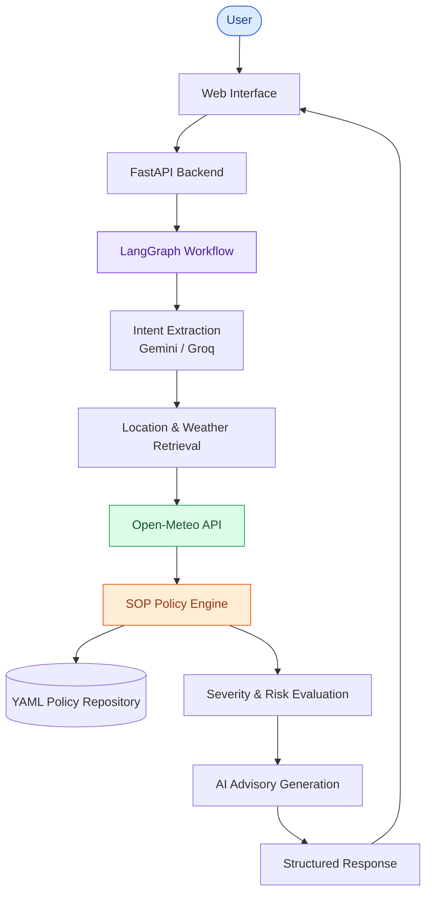

# Weather Advisory Bot – MediBuddy

### AI-Powered Weather-Based Safety Advisory System

An intelligent weather advisory assistant that combines **LLMs, LangGraph, real-time weather data, and configurable Standard Operating Procedures (SOPs)** to provide context-aware outdoor activity safety recommendations.

## Live Demo

**Deployed Application:** [Weather Advisory Bot – MediBuddy](https://weather-advisory-bot-medibuddy.onrender.com/)

**Deployment Platform:** Render

## Features

- **Natural Language Interaction:** Understands conversational weather queries.
- **Live Weather Integration:** Retrieves current and forecasted weather using Open-Meteo.
- **AI-Powered Intent Extraction:** Uses Google Gemini with Groq fallback.
- **LangGraph Workflow:** Orchestrates the complete advisory pipeline.
- **SOP-Based Evaluation:** Matches weather conditions against configurable safety policies.
- **Severity-Based Decisions:** Categorizes risks into Critical, High, Moderate, and Normal.
- **Session Memory:** Supports contextual follow-up conversations.
- **FastAPI Backend:** Provides REST API endpoints.
- **Swagger Documentation:** Interactive API testing through Swagger UI.
- **Evaluation Framework:** Tests policy matching, edge cases, and failure scenarios.

## Technology Stack

| Technology | Purpose |
|---|---|
| Python | Core development |
| FastAPI | Backend and REST APIs |
| LangGraph | AI workflow orchestration |
| Google Gemini | LLM-based intent extraction |
| Groq | LLM fallback |
| Open-Meteo | Weather and geocoding APIs |
| YAML | SOP configuration |
| Pydantic | Data validation |
| Pytest | Testing |
| Render | Cloud deployment |

## System Architecture



## Installation and Setup

### 1. Clone the Repository

```bash
git clone https://github.com/Divyansh010605/Weather-Advisory-Bot-Medibuddy.git

cd Weather-Advisory-Bot-Medibuddy
```

### 2. Create a Virtual Environment

**Windows:**

```bash
python -m venv venv
venv\Scripts\activate
```

**Linux / macOS:**

```bash
python3 -m venv venv
source venv/bin/activate
```

### 3. Install Dependencies

```bash
pip install -r requirements.txt
```

### 4. Configure Environment Variables

Create a `.env` file using `.env.example`.

```env
GEMINI_API_KEY=your_gemini_api_key
GROQ_API_KEY=your_groq_api_key
```

### 5. Run the Application

```bash
python app.py
```

Alternatively:

```bash
uvicorn app:app --host 0.0.0.0 --port 8000 --reload
```

Access the application at:

`http://localhost:8000`

## API Documentation

FastAPI automatically generates interactive API documentation.

| Method | Endpoint | Description |
|---|---|---|
| GET | `/` | Web application |
| GET | `/health` | Health check |
| GET | `/api/sops` | Retrieve safety policies |
| POST | `/chat` | Process weather advisory queries |

## Testing

Run unit tests:

```bash
pytest
```

Run the evaluation framework:

```bash
python run_evals.py
```

## Project Structure

```text
Weather-Advisory-Bot-Medibuddy/
│
├── src/
├── policies/
├── static/
├── evals/
├── tests/
├── app.py
├── requirements.txt
├── .env.example
└── README.md
```

## Disclaimer

This project provides experimental, weather-based decision support. Its recommendations do not replace official meteorological alerts, emergency instructions, or professional safety assessments.

## Author

**Divyansh Khandelwal**

- GitHub: [@Divyansh010605](https://github.com/Divyansh010605)
- LinkedIn: [Divyansh Khandelwal](https://www.linkedin.com/in/divyansh-khandelwal-b208a82a1/)

---

<p align="center">
  Built with Python, FastAPI, LangGraph, and AI.
  <br/>
  <b>Turning Weather Intelligence into Actionable Safety Decisions.</b>
</p>